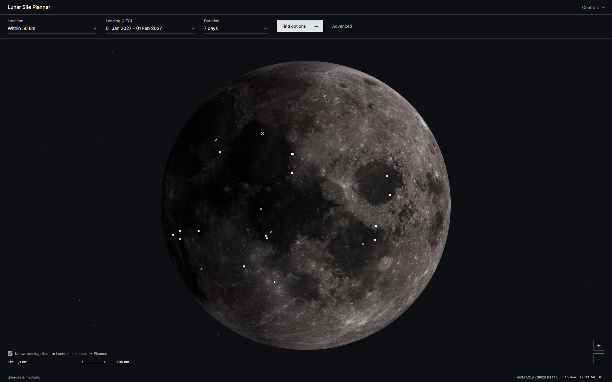
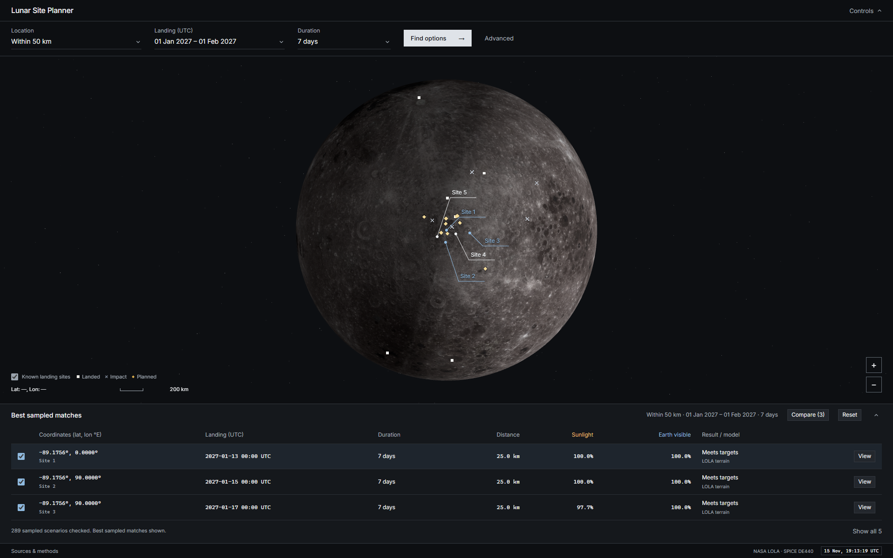
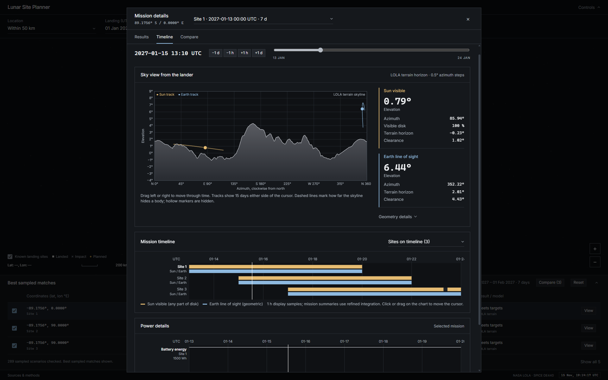

# Lunar Site Planner

Explore where and when to land on the Moon. Compare sunlight, Earth visibility,
and solar power across lunar locations, landing dates, and mission durations using
NASA/JPL SPICE geometry and NASA LRO/LOLA terrain data.

**[Open Lunar Site Planner](https://lunarsiteplanner.com)** ·
[Release notes](CHANGELOG.md) · [Development guide](docs/DEVELOPMENT.md) ·
[Sources and assumptions](docs/REFERENCES_AND_ASSUMPTIONS.md)

Official Site: https://lunarsiteplanner.com/

NASA Space App Submission: https://www.spaceappschallenge.org/2026/find-a-team/seraphim/?tab=project

Demo Video: https://www.youtube.com/watch?v=2hjhapZHjLc

Built by **Project Seraphim** for the **2026 NASA Space Apps Challenge**.



## Plan a mission

- **Choose a location.** Enter coordinates, select a point on the 3D Moon, or search
  anywhere or within a radius. Known landing sites provide geographic context.
- **Choose when and how long.** Fix a landing time and duration to analyze one
  mission, or leave fields open to find sampled alternatives.
- **Set your targets.** Advanced controls expose sunlight and Earth-visibility
  targets, outage limits, Earth clearance, and solar-panel, load, and battery assumptions.
- **Inspect and compare.** Open a result for detailed metrics and synchronized
  Sun/Earth horizon and mission timelines. Compare up to twelve scenarios and
  export CSV or JSON with their parameters, assumptions, and references.

Drag the Moon to rotate and scroll or use +/− to zoom. Mission dates and timeline
controls use UTC; the footer clock supports other display time zones. Comparison
selections are saved in your browser until removed or reset.

## Search and compare

**Find options** explores the location, date, or duration fields left open, then
refines and ranks a shortlist against your targets. Five sampled matches are
available, with three shown initially. Check a row to include it in **Compare**;
use **View** to inspect that mission.



Search explores a bounded grid and does not establish a global optimum. Duration
ranges sample up to eight lengths. The initial 50% visibility targets are editable
project assumptions, not NASA requirements.

## Understand the timeline

The **Timeline** view connects the lander's local terrain skyline to Sun and Earth
positions, visibility windows, and power estimates. Move the shared time cursor
to see how terrain and mission timing affect each scenario.



Screenshots supplied by the team on November 15, 2026 show the working application
and example scenarios. Their values depend on the selected inputs and assumptions.
The globe's viewing light is contextual; the calculated local horizon determines
scientific visibility.

## Run locally

Install Node.js 20.19+ or 22.12+ and npm, then:

```sh
git clone https://github.com/jwhiting07/Lunar-Site-Planner.git
cd Lunar-Site-Planner
npm ci
npm run dev -- --host 127.0.0.1 --port 5200 --strictPort
```

Open [localhost:5200](http://127.0.0.1:5200). Python is optional for the shipped
datasets; it is needed for data regeneration, scientific validation, and on-demand
terrain at uncached coordinates.

```sh
npm test
npm run build
npm run preview
```

The production build is written to `dist/`. Static hosting supports the shipped
terrain profiles; uncached custom coordinates require a terrain service. See the
[development guide](docs/DEVELOPMENT.md) for setup, deployment, and reproduction.

## Data and scientific scope

The application combines DE440 ephemerides and lunar orientation kernels from
NASA/JPL NAIF with NASA LOLA elevation products. Nine shipped sites include two
as-landed CLPS positions and seven representative points; 49 exact default
search-grid locations also have precomputed terrain profiles. Custom locations
use a flat-horizon preview until an exact-coordinate terrain profile is available.

Shipped ephemerides cover **September 13, 1959 through the January 1, 2029 UTC
boundary**. Searches without a date explore 2026–2028; select an exact date or range
for earlier missions. Durations range from one hour to 365 days and must fit the
available ephemeris interval.

Final summaries use 15-minute integration with 5-minute probes near detected
horizon transitions. Charts and exported series retain hourly display samples.
Recorded checks compare the calculations with direct SPICE, finer time and terrain
sampling, published maps, a limited exhaustive search reference, and an independent
numerical battery calculation. Numerical budgets are the team's choices.

This is an educational planning prototype. Earth visibility means geometric line
of sight, not a radio link budget. Power estimates assume generic hardware and
ideal storage. Terrain below the source resolution and events between calculation
probes can be missed. The tool does not assess landing safety or thermal survival.

## Documentation and credits

| Document | Contents |
| --- | --- |
| [Development guide](docs/DEVELOPMENT.md) | Local terrain service, deployment, data regeneration, and checks |
| [References and assumptions](docs/REFERENCES_AND_ASSUMPTIONS.md) | Source URLs, versions, and modeling assumptions |
| [Calculation traceability](docs/CALCULATION_TRACEABILITY.md) | Connections between outputs, equations, code, and datasets |
| [Validation](docs/VALIDATION.md) | Reference comparisons and measured limitations |
| [Mission-level validity](docs/VALIDITY.md) | Convergence, terrain, search, and battery evidence |
| [Verification history](docs/VERIFICATION.md) | Recorded implementation and browser checks |
| [Materials and tools inventory](docs/THIRD_PARTY_AUDIT.md) | Data, software, assets, and licensing evidence |
| [UI reference](docs/ui/README.md) | Reviewed design direction and historical reference layouts |

Project code is licensed under [MIT](LICENSE). External datasets, models, and fonts
retain their providers' terms. Credit NASA/JPL NAIF, NASA LRO/LOLA and GSFC PGDA,
NASA/LROC, NASA's Scientific Visualization Studio, and the Yale Bright Star Catalog
hosted by NASA/GSFC HEASARC. Source and asset checksums are recorded under
`public/data/`, `public/models/`, and `public/textures/`; Inter's license is in
[`public/fonts/OFL.txt`](public/fonts/OFL.txt).

OpenAI Codex assisted code, interface development, documentation, and submission
preparation. Anthropic Claude Opus 5.5 assisted code. The application is hosted on
Vercel. The demo plan uses OBS Studio for screen capture and DaVinci Resolve for editing. The KaTeX math fonts use
SIL OFL 1.1, with their notice in [`public/fonts/KaTeX-OFL.txt`](public/fonts/KaTeX-OFL.txt).
Scientific values are calculated by the documented numerical pipeline from the
cited source data. This team project is not endorsed by NASA.
